# Physical data model

The PostgreSQL schema of Flexstore, as created by the Flyway migrations of `backend/migrations` (last migration: **V17**). Update this diagram in the same pull request as any migration that changes the schema (see the `database-convention` skill).

The image is generated from the diagram below by `docs/render-database-diagram.sh`.

```mermaid
%%{init: {"theme": "base", "themeVariables": {"primaryColor": "#DBEAFE", "primaryTextColor": "#111827", "primaryBorderColor": "#1D4ED8", "lineColor": "#374151", "secondaryColor": "#F3F4F6", "tertiaryColor": "#FFFFFF", "attributeBackgroundColorOdd": "#FFFFFF", "attributeBackgroundColorEven": "#F1F5F9"}}}%%
erDiagram
    user {
        varchar(50) id PK
        varchar(255) first_name
        varchar(255) last_name
        text email UK
        text password "bcrypt hash"
        text role "USER or ADMIN"
        varchar(30) status "PENDING_VERIFICATION, ACTIVE, SUSPENDED, LOCKED or DISABLED"
        varchar(30) phone_number "nullable"
        timestamp created_at
        timestamp updated_at
    }

    email_verification {
        varchar(64) token_hash PK "SHA-256 of the token of the link"
        varchar(50) user_id FK
        timestamptz expires_at
        timestamp created_at
        timestamp updated_at
    }

    address {
        varchar(50) id PK
        varchar(20) recipient_type "PRIVATE_INDIVIDUAL or LEGAL_ENTITY"
        varchar(255) first_name "required for a person, optional contact of a company"
        varchar(255) last_name "required for a person, optional contact of a company"
        varchar(255) company_name "required for a company"
        varchar(30) vat_number "nullable"
        varchar(255) street
        varchar(255) complement "nullable"
        varchar(20) postal_code
        varchar(100) city
        varchar(100) country
        timestamp created_at
        timestamp updated_at
    }

    user_address {
        varchar(50) id PK
        varchar(50) user_id FK,UK "unique with address_id"
        varchar(50) address_id FK,UK
        int position "order of the addresses of the user"
        timestamp created_at
        timestamp updated_at
    }

    product {
        varchar(50) id PK
        text name
        text description
        varchar(30) category "CLOTHING, ELECTRONICS or ACCESSORIES"
        numeric price
        varchar(3) currency
        timestamp created_at
        timestamp updated_at
    }

    cart {
        varchar(50) id PK
        varchar(50) user_id FK,UK "nullable: the cart of a visitor"
        timestamp created_at
        timestamp updated_at
    }

    cart_item {
        varchar(50) id PK
        varchar(50) cart_id FK,UK "unique with product_id"
        varchar(50) product_id FK,UK
        int quantity "greater than 0"
        timestamp created_at
        timestamp updated_at
    }

    customer_order {
        varchar(50) id PK
        varchar(50) user_id FK
        varchar(20) status "AWAITING_PAYMENT, PAID, PROCESSING, SHIPPED or DELIVERED"
        timestamptz placed_at
        varchar(50) delivery_address_id FK
        varchar(50) billing_address_id FK
        varchar(50) payment_id FK "nullable: last payment started"
        timestamp created_at
        timestamp updated_at
    }

    customer_order_line {
        varchar(50) id PK
        varchar(50) order_id FK,UK "unique with position"
        int position UK
        varchar(50) product_id "copy, no foreign key: the order history does not depend on the catalog"
        text product_name "copy at the time of the order"
        numeric unit_price "copy at the time of the order"
        varchar(3) currency
        int quantity "greater than 0"
        timestamp created_at
        timestamp updated_at
    }

    payment {
        varchar(50) id PK
        varchar(255) provider_reference UK "id of the Stripe Checkout session"
        text checkout_url
        varchar(10) outcome "PENDING or PAID"
        timestamp created_at
        timestamp updated_at
    }

    shop_settings {
        int id PK "a single row (id = 1)"
        varchar(10) order_confirmation_email "ENABLED or DISABLED"
        timestamp created_at
        timestamp updated_at
    }

    user ||--o{ email_verification : "user_id (cascade)"
    user ||--o{ user_address : "user_id (cascade)"
    address ||--o{ user_address : "address_id"
    user |o--o| cart : "user_id (cascade)"
    cart ||--o{ cart_item : "cart_id (cascade)"
    product ||--o{ cart_item : "product_id (cascade)"
    user ||--o{ customer_order : "user_id (cascade)"
    customer_order ||--|{ customer_order_line : "order_id (cascade)"
    address ||--o{ customer_order : "delivery_address_id"
    address ||--o{ customer_order : "billing_address_id"
    payment |o--o{ customer_order : "payment_id"
```

## Notes

- Every table has a technical primary key `id` (generated by the application), and the creation and last update dates `created_at` / `updated_at` (set by Hibernate).
- An `address` belongs to no user: the users refer to their addresses through `user_address`, the orders through `delivery_address_id` and `billing_address_id`. Editing an address creates a new row, removing it from a user deletes only its `user_address` row: an order always keeps the address it was delivered and billed to.
- `user` is quoted in SQL (`"user"`), a reserved word; the orders are stored in `customer_order` for the same reason.
- Not yet in line with the `database-convention` skill: `email_verification` has the token hash as primary key (instead of an `id`, referenced from `"user".email_verification_id`), and `customer_order_line.order_id` is not named after the table it references (`customer_order_id`).
