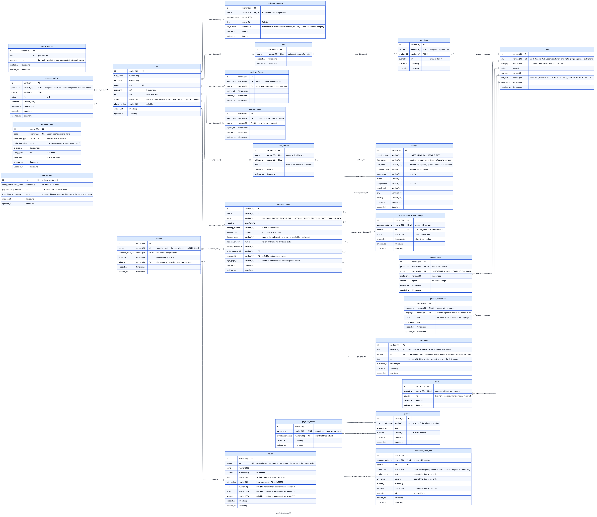

# Physical data model

The PostgreSQL schema of Flexstore, as created by the Flyway migrations of `backend/migrations` (last migration: **V60**). Update this diagram in the same pull request as any migration that changes the schema (see the `database-convention` skill).

The image is generated from the diagram below by `docs/render-database-diagram.sh`. Each column is written with its name first, then its type, so that the image shows them in this order. The diagram is laid out from left to right by ELK, without crossing links: the relations are written from the table that holds the foreign key towards the table it references when that one should be placed on the right (`address`, `payment`, `product`).

```mermaid
%%{init: {"layout": "elk", "theme": "base", "themeVariables": {"primaryColor": "#DBEAFE", "primaryTextColor": "#111827", "primaryBorderColor": "#1D4ED8", "lineColor": "#374151", "secondaryColor": "#F3F4F6", "tertiaryColor": "#FFFFFF", "attributeBackgroundColorOdd": "#FFFFFF", "attributeBackgroundColorEven": "#F1F5F9"}}}%%
erDiagram
    direction LR

    user {
        id varchar(50) PK
        first_name varchar(255)
        last_name varchar(255)
        email text UK
        password text "bcrypt hash"
        role text "USER or ADMIN"
        status varchar(30) "PENDING_VERIFICATION, ACTIVE, SUSPENDED, LOCKED or DISABLED"
        phone_number varchar(30) "nullable"
        two_factor_secret varchar(64) "nullable: TOTP secret, set once an enrollment starts"
        two_factor_status varchar(20) "nullable: PENDING or ENABLED, null with two_factor_secret"
        created_at timestamp
        updated_at timestamp
    }

    customer_company {
        id varchar(50) PK
        user_id varchar(50) FK,UK "at most one company per user"
        company_name varchar(255)
        siren varchar(9) "9 digits"
        vat_number varchar(30) "nullable: intra-community VAT number, FR + key + SIREN for a French company"
        created_at timestamp
        updated_at timestamp
    }

    failed_sign_in {
        id varchar(50) PK
        user_id varchar(50) FK,UK "at most one row per account, only while the count is above 0"
        attempt_count int "failed sign-ins in a row, 1 to 4: at the 5th the account is locked and the row deleted"
        created_at timestamp
        updated_at timestamp
    }

    user_token {
        id varchar(50) PK
        type varchar(30) "EMAIL_VERIFICATION or PASSWORD_RESET"
        token_hash varchar(64) UK "SHA-256 of the token of the link"
        user_id varchar(50) FK "several verification links over time, only the last password reset link"
        expires_at timestamptz
        created_at timestamp
        updated_at timestamp
    }

    refresh_session {
        id varchar(50) PK
        token_hash varchar(64) UK "SHA-256 of the refresh token"
        user_id varchar(50) FK "a user may have several sessions"
        expires_at timestamptz "7 days after the session is opened"
        revoked_at timestamptz "nullable: set when the refresh token is used or the user signs out"
        created_at timestamp
        updated_at timestamp
    }

    user_address {
        id varchar(50) PK
        user_id varchar(50) FK,UK "unique with address_id"
        address_id varchar(50) FK,UK
        position int "order of the addresses of the user"
        created_at timestamp
        updated_at timestamp
    }

    customer_order {
        id varchar(50) PK
        user_id varchar(50) FK
        status varchar(20) "last status: AWAITING_PAYMENT, PAID, PROCESSING, SHIPPED, DELIVERED, CANCELLED or REFUNDED"
        placed_at timestamptz
        shipping_method varchar(20) "STANDARD or EXPRESS"
        shipping_cost numeric "0 or more, 0 when free"
        discount_code varchar(30) "copy of the code used, no foreign key; nullable: no discount"
        discount_amount numeric "taken off the items, 0 without code"
        delivery_address_id varchar(50) FK
        billing_address_id varchar(50) FK
        payment_id varchar(50) FK "nullable: last payment started"
        legal_page_id varchar(50) FK "terms of sale accepted; nullable: placed before"
        tracking_carrier varchar(20) "nullable: COLISSIMO, CHRONOPOST, UPS, DHL, FEDEX or OTHER, given with the number"
        tracking_number varchar(40) "nullable: the parcel of a shipped order; given together with the carrier"
        created_at timestamp
        updated_at timestamp
    }

    cart {
        id varchar(50) PK
        user_id varchar(50) FK,UK "nullable: the cart of a visitor"
        last_changed_at timestamptz "the items of the cart last changed"
        reminded_at timestamptz "nullable: the customer was reminded of the cart, until it changes again"
        created_at timestamp
        updated_at timestamp
    }

    address {
        id varchar(50) PK
        recipient_type varchar(20) "PRIVATE_INDIVIDUAL or LEGAL_ENTITY"
        first_name varchar(255) "required for a person, optional contact of a company"
        last_name varchar(255) "required for a person, optional contact of a company"
        company_name varchar(255) "required for a company"
        vat_number varchar(30) "nullable"
        street varchar(255)
        complement varchar(255) "nullable"
        postal_code varchar(20)
        city varchar(100)
        country varchar(100)
        created_at timestamp
        updated_at timestamp
    }

    payment {
        id varchar(50) PK
        provider_reference varchar(255) UK "id of the Stripe Checkout session"
        checkout_url text
        outcome varchar(10) "PENDING or PAID"
        created_at timestamp
        updated_at timestamp
    }

    payment_refund {
        id varchar(50) PK
        payment_id varchar(50) FK,UK "at most one refund per payment"
        provider_reference varchar(255) UK "id of the Stripe refund"
        created_at timestamp
        updated_at timestamp
    }

    customer_order_status_change {
        id varchar(50) PK
        customer_order_id varchar(50) FK,UK "unique with position"
        position int UK "0: placed, then each status reached"
        status varchar(20) "the status reached"
        changed_at timestamptz "when it was reached"
        created_at timestamp
        updated_at timestamp
    }

    invoice {
        id varchar(50) PK
        number varchar(20) UK "year then rank in the year, without gaps: 2026-000042"
        customer_order_id varchar(50) FK,UK "one invoice per paid order"
        issued_at timestamptz "when the order was paid"
        seller_id varchar(50) FK "the version of the seller current at the issue"
        created_at timestamp
        updated_at timestamp
    }

    seller {
        id varchar(50) PK
        version int UK "never changed: each edit adds a version, the highest is the current seller"
        name varchar(255)
        address varchar(500) "on one line"
        siret varchar(20) "14 digits, maybe grouped by spaces"
        vat_number varchar(20) "intra-community: FR12345678901"
        phone varchar(30) "nullable: none in the versions written before V35"
        email varchar(255) "nullable: none in the versions written before V35"
        website varchar(255) "nullable: none in the versions written before V35"
        legal_form varchar(50) "SAS, SARL...; nullable: none in the versions written before V40"
        share_capital varchar(30) "in euros: 10 000; nullable: none in the versions written before V40"
        registry_city varchar(100) "of the trade register (RCS); nullable: none before V40"
        facebook_url varchar(255) "web address of the account; nullable: none given, or none before V51"
        instagram_url varchar(255) "nullable: none given, or none before V51"
        x_url varchar(255) "nullable: none given, or none before V51"
        tiktok_url varchar(255) "nullable: none given, or none before V51"
        youtube_url varchar(255) "nullable: none given, or none before V51"
        twitch_url varchar(255) "nullable: none given, or none before V51"
        created_at timestamp
        updated_at timestamp
    }

    legal_page {
        id varchar(50) PK
        kind varchar(20) UK "LEGAL_NOTICE, TERMS_OF_SALE or PRIVACY_POLICY, unique with version"
        version int UK "never changed: each publication adds a version, the highest is the current page"
        text text "plain text, 50 000 characters at most; empty in the first version"
        published_at timestamptz
        created_at timestamp
        updated_at timestamp
    }

    discount_code {
        id varchar(50) PK
        code varchar(30) UK "upper-case letters and digits"
        reduction_type varchar(10) "PERCENTAGE or AMOUNT"
        reduction_value numeric "1 to 100 (percent), or euros; more than 0"
        expires_at timestamptz
        usage_limit int "1 or more"
        times_used int "0 to usage_limit"
        created_at timestamp
        updated_at timestamp
    }

    document_counter {
        id varchar(50) PK
        kind varchar(20) UK "INVOICE or CREDIT_NOTE, unique with year"
        year int UK "year of issue"
        last_rank int "last rank given in the year to the documents of the kind, incremented with each one"
        created_at timestamp
        updated_at timestamp
    }

    credit_note {
        id varchar(50) PK
        number varchar(20) UK "AV, year then rank in the year, without gaps: AV-2026-000007"
        invoice_id varchar(50) FK,UK "the invoice it cancels, one credit note per refunded order"
        issued_at timestamptz "when the order was refunded"
        created_at timestamp
        updated_at timestamp
    }

    customer_order_line {
        id varchar(50) PK
        customer_order_id varchar(50) FK,UK "unique with position"
        position int UK
        product_id varchar(50) "copy, no foreign key: the order history does not depend on the catalog"
        product_name text "copy at the time of the order"
        unit_price numeric "copy at the time of the order"
        currency varchar(3)
        vat_rate varchar(20) "copy at the time of the order"
        quantity int "greater than 0"
        created_at timestamp
        updated_at timestamp
    }

    product_image {
        id varchar(50) PK
        product_id varchar(50) FK,UK "unique with format"
        format varchar(10) UK "LARGE (500 KB at most) or SMALL (60 KB at most)"
        media_type varchar(30) "image/jpeg"
        content bytea "the resized image"
        created_at timestamp
        updated_at timestamp
    }

    product_translation {
        id varchar(50) PK
        product_id varchar(50) FK,UK "unique with language"
        language varchar(2) UK "en or fr: a product always has its row in en"
        name text "the name of the product in this language"
        description text
        created_at timestamp
        updated_at timestamp
    }

    user_setting {
        id varchar(50) PK
        user_id varchar(50) FK,UK "unique with name: at most one row per customer and setting"
        name varchar(30) UK "authorized names: color_mode, language or cookie_choice"
        value varchar(20) "LIGHT or DARK, EN or FR, ACCEPTED or REFUSED, by name"
        expires_at timestamptz "nullable: filled for cookie_choice only, when the customer is asked again"
        created_at timestamp
        updated_at timestamp
    }

    cart_item {
        id varchar(50) PK
        cart_id varchar(50) FK,UK "unique with product_id"
        product_id varchar(50) FK,UK
        quantity int "greater than 0"
        created_at timestamp
        updated_at timestamp
    }

    product {
        id varchar(50) PK
        sku varchar(32) UK "Stock Keeping Unit: upper-case letters and digits, groups separated by hyphens"
        category varchar(30) "CLOTHING, ELECTRONICS or ACCESSORIES"
        price numeric
        currency varchar(3)
        vat_rate varchar(20) "STANDARD, INTERMEDIATE, REDUCED or SUPER_REDUCED: 20, 10, 5.5 or 2.1 %"
        promotion_percentage numeric "nullable: percentage off the price, from more than 0 to 100"
        promotion_starts_at timestamptz "nullable: the promotion starts (included); the three promotion columns are all filled or all empty"
        promotion_ends_at timestamptz "nullable: the promotion ends (excluded), after its start"
        stock_quantity int "nullable: units the shop has, 0 or more, orders awaiting payment reserved; null while the stock was never given"
        stock_alert_threshold int "the administrators are warned at or under it: 5 by default"
        created_at timestamp
        updated_at timestamp
    }

    product_review {
        id varchar(50) PK
        product_id varchar(50) FK,UK "unique with user_id: one review per customer and product"
        user_id varchar(50) FK,UK
        rating int "1 to 5"
        comment varchar(1000)
        reviewed_at timestamptz
        created_at timestamp
        updated_at timestamp
    }

    wishlist_item {
        id varchar(50) PK
        user_id varchar(50) FK,UK "unique with product_id: a product saved once per customer"
        product_id varchar(50) FK,UK
        created_at timestamp
        updated_at timestamp
    }

    shop_settings {
        id int PK "a single row (id = 1)"
        order_confirmation_email varchar(10) "ENABLED or DISABLED"
        payment_delay_minutes int "1 to 1440: time to pay an order"
        free_shipping_threshold numeric "standard shipping free from this price of the items (0 or more)"
        seller_setup varchar(10) "ENABLED once the setup assistant of the seller is finished (read only)"
        abandoned_cart_reminder varchar(20) "ENABLED or DISABLED: the email that reminds a customer of their abandoned cart"
        abandoned_cart_delay_hours int "1 to 720: time a cart is left before its customer is reminded"
        created_at timestamp
        updated_at timestamp
    }

    shop_page_content {
        id varchar(50) PK
        page_type varchar(50) UK "META_KEY_WORDS, GOOGLE_ANALYTICS_ID or META_SHOP_DESCRIPTION"
        content text "empty until the administrators write it"
        created_at timestamp
        updated_at timestamp
    }

    user ||--o{ user_token : "user_id (cascade)"
    user ||--o| customer_company : "user_id (cascade)"
    user ||--o{ user_setting : "user_id (cascade)"
    user ||--o| failed_sign_in : "user_id (cascade)"
    user ||--o{ refresh_session : "user_id (cascade)"
    user ||--o{ user_address : "user_id (cascade)"
    user_address }o--|| address : "address_id"
    user ||--o{ customer_order : "user_id (cascade)"
    customer_order }o--|| address : "delivery_address_id"
    customer_order }o--|| address : "billing_address_id"
    customer_order }o--o| payment : "payment_id"
    customer_order }o--o| legal_page : "legal_page_id"
    payment_refund |o--|| payment : "payment_id (cascade)"
    customer_order ||--|{ customer_order_line : "customer_order_id (cascade)"
    invoice |o--|| customer_order : "customer_order_id"
    invoice }o--|| seller : "seller_id"
    credit_note |o--|| invoice : "invoice_id"
    customer_order ||--|{ customer_order_status_change : "customer_order_id (cascade)"
    user |o--o| cart : "user_id (cascade)"
    cart ||--o{ cart_item : "cart_id (cascade)"
    cart_item }o--|| product : "product_id (cascade)"
    product_image }o--|| product : "product_id (cascade)"
    product_translation }o--|| product : "product_id (cascade)"
    product_review }o--|| product : "product_id (cascade)"
    product_review }o--|| user : "user_id (cascade)"
    wishlist_item }o--|| product : "product_id (cascade)"
    wishlist_item }o--|| user : "user_id (cascade)"
```

## Notes

- Every table has a technical primary key `id` (generated by the application), and the creation and last update dates `created_at` / `updated_at` (set by Hibernate).
- An `address` belongs to no user: the users refer to their addresses through `user_address`, the orders through `delivery_address_id` and `billing_address_id`. Editing an address creates a new row, removing it from a user deletes only its `user_address` row: an order always keeps the address it was delivered and billed to.
- The `seller` written on the invoices is edited by the administrators. Each edit adds a version and never changes one: an `invoice` references the version current when it was issued, so that it keeps the seller it was issued with. Its legal form, its share capital and the city of its trade register are asked since V40, which adds a version of the demonstration seller with them while it is still the current one; the versions written before have none. Its accounts on the social networks (Facebook, Instagram, X, TikTok, YouTube, Twitch) are asked since V51, each one optional: the footer of the shop shows the ones that are given, and the versions written before have none.
- A `credit_note` cancels the `invoice` of a refunded order, and is written with the seller of that invoice. The credit notes have their own sequence of numbers, as the invoices (one row of `document_counter` per kind and year, V60 merged the former `invoice_counter` and `credit_note_counter` tables); V39 issues the credit notes of the orders refunded before it, dated when they were refunded.
- The `legal_page` rows are the legal notice, the terms of sale and the privacy policy of the shop, written by the administrators and read by everyone. Each publication adds a version of its kind and never changes one, so that the terms of sale of a given date can be found again. The migration creates a first, empty version of each kind; V38 adds a standard version of each one, written with the current seller, while its current version is still empty. V55 adds the privacy policy: a first, empty version, then its standard version, in the same way. An order keeps the version of the terms of sale its customer accepted (`legal_page_id`); the orders placed before V37 have none.
- A customer who creates their account for their company gives it once: its `customer_company` row (name, SIREN, VAT number). The address they give is then addressed to the company, for their attention (`address.recipient_type` `LEGAL_ENTITY`, with the company name and the VAT number).
- The settings of a signed-in customer are `user_setting` rows (V58 merged the former `cookie_consent` and `user_preference` tables into it): one row per setting the customer chose, at most one per customer and `name`, replaced by each new choice. A new setting is a new authorized name (and its authorized values) in the checks of the table, not a new column. A customer who never chose a setting has no row for it.
  - `cookie_choice`: their choice about the preference cookies (`ACCEPTED` or `REFUSED`), valid until `expires_at` (6 months after the choice, then the customer is asked again; `expires_at` is filled for this setting only). A visitor who is not signed in keeps theirs in their browser; at sign-in it is recorded here and removed from the browser;
  - `color_mode`: their display mode (`LIGHT` or `DARK`); without a row, their browser decides. A visitor who is not signed in keeps theirs in their browser (when they accepted the preference cookies);
  - `language`: their preferred language (`EN` or `FR`); without a row, the page decides.
- A wrong password for an existing account adds one to its `failed_sign_in` row (created by the first failure). At the 5th failure in a row, the account becomes `LOCKED` and the row is deleted, so that the count starts again when an administrator reactivates the account; a successful sign-in deletes the row too. An email that belongs to no account, and an account that cannot sign in already, are not counted.
- A `refresh_session` is a session of a signed-in user: its refresh token renews their access token (15 minutes) once, then the session is revoked (`revoked_at`) and replaced by a new row. A revoked token that comes back revokes every open session of its user. Only the hash of the token is stored; deleting a user deletes their sessions.
- The carrier and the tracking number of the parcel of an order are given together by an administrator when the order is shipped, or corrected afterwards (`tracking_carrier` and `tracking_number`, a check forbids one without the other); the orders shipped before V45, or shipped without them, have none.
- The `shop_page_content` rows are what the administrators write for the head of the shop pages: one row for each `page_type` (the key words, the description of the shop, the Google Analytics identifier), all created empty by V57. A new type is a new row, not a column. They are read by everyone, edited by the administrators, and kept in a cache that every edit evicts.
- `user` is quoted in SQL (`"user"`), a reserved word; the orders are stored in `customer_order` for the same reason.
- The name and the description of a `product` are in `product_translation`, one row per language: always one in the default language (`en`), which the application requires, and one per other language the product is translated into. A product without a translation in the language of the customer is shown in `en`.
- A `wishlist_item` is a product a customer saved to buy it back later: at most one row per customer and product (saving it again changes nothing). Removing it from the wishlist only deletes this row, not the product or the orders already placed for it.
- The stock of a `product` is two of its columns (V59 merged the former `stock` table into `product`): `stock_quantity`, the units the shop has, and `stock_alert_threshold`, the units at or under which the administrators are warned (5 by default). `stock_quantity` is empty while the stock was never given: such a product has no units, an order for it is refused, and it is not listed among the low stocks.
