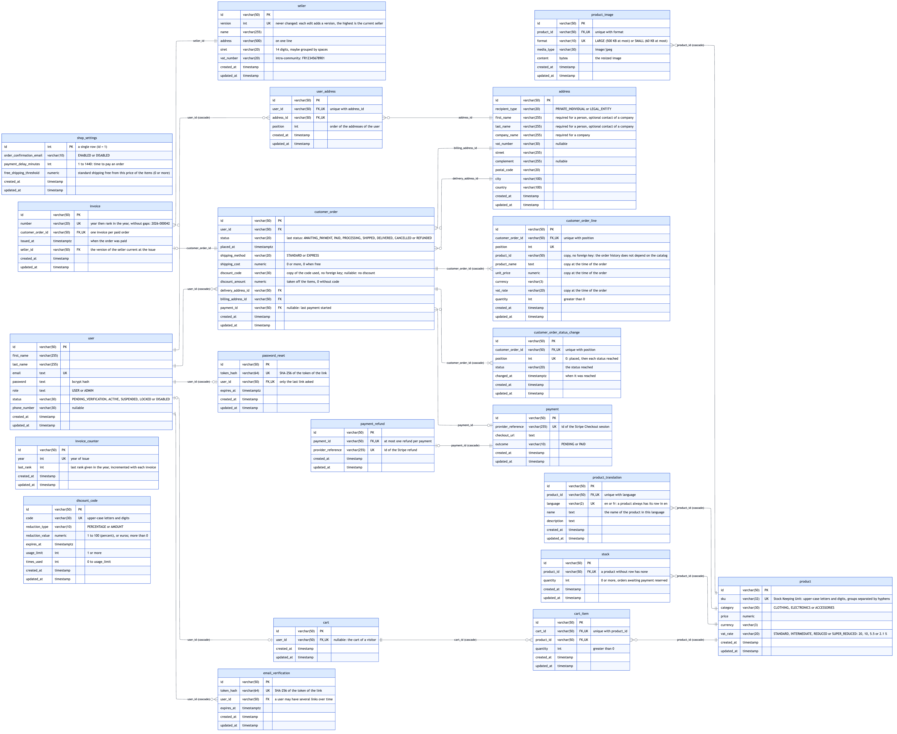
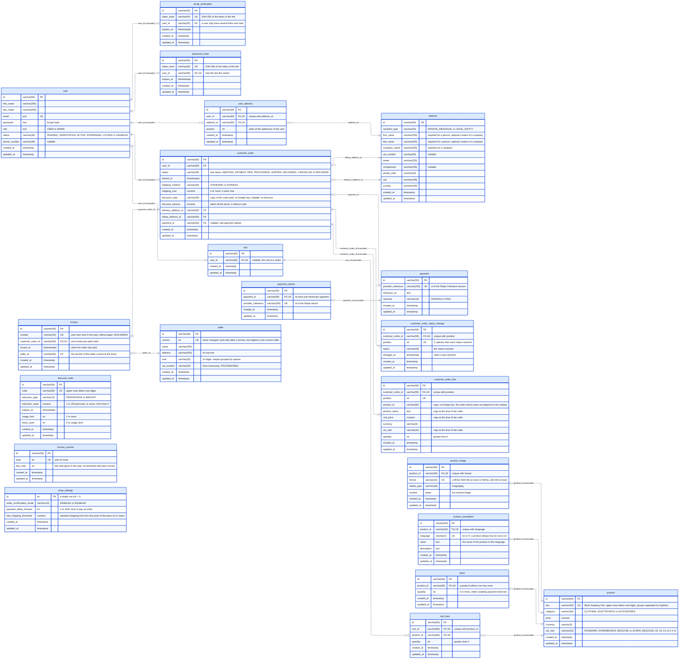

# Physical data model

The PostgreSQL schema of Flexstore, as created by the Flyway migrations of `backend/migrations` (last migration: **V32**). Update this diagram in the same pull request as any migration that changes the schema (see the `database-convention` skill).

The image is generated from the diagram below by `docs/render-database-diagram.sh`. Each column is written with its name first, then its type, so that the image shows them in this order. The diagram is laid out from left to right by ELK, without crossing links: the relations are written from the table that holds the foreign key towards the table it references when that one should be placed on the right (`address`, `payment`, `product`).

## Notes

- Every table has a technical primary key `id` (generated by the application), and the creation and last update dates `created_at` / `updated_at` (set by Hibernate).
- An `address` belongs to no user: the users refer to their addresses through `user_address`, the orders through `delivery_address_id` and `billing_address_id`. Editing an address creates a new row, removing it from a user deletes only its `user_address` row: an order always keeps the address it was delivered and billed to.
- The `seller` written on the invoices is edited by the administrators. Each edit adds a version and never changes one: an `invoice` references the version current when it was issued, so that it keeps the seller it was issued with.
- `user` is quoted in SQL (`"user"`), a reserved word; the orders are stored in `customer_order` for the same reason.
- The name and the description of a `product` are in `product_translation`, one row per language: always one in the default language (`en`), which the application requires, and one per other language the product is translated into. A product without a translation in the language of the customer is shown in `en`.
